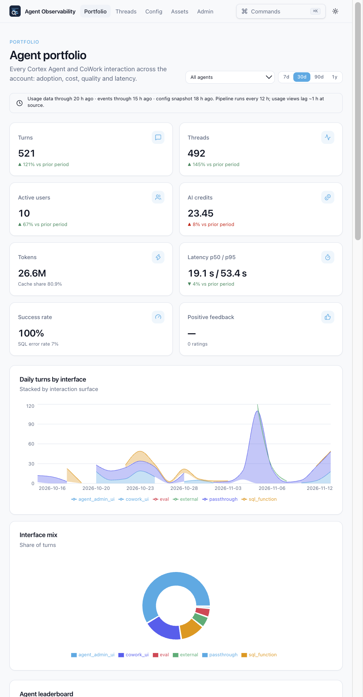
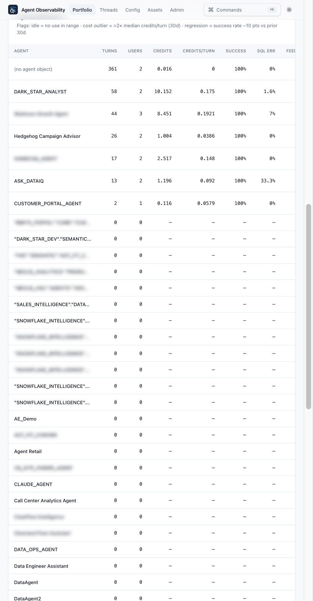
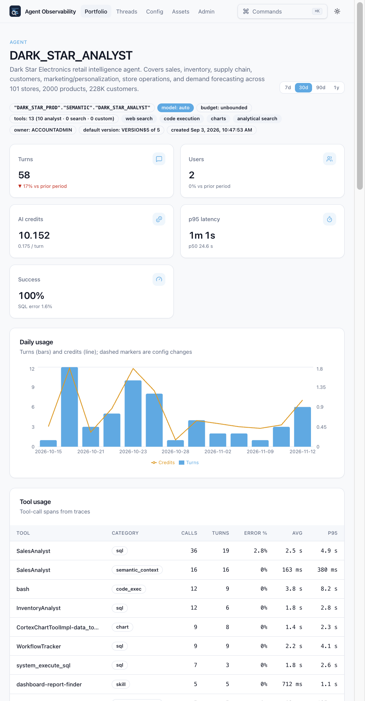
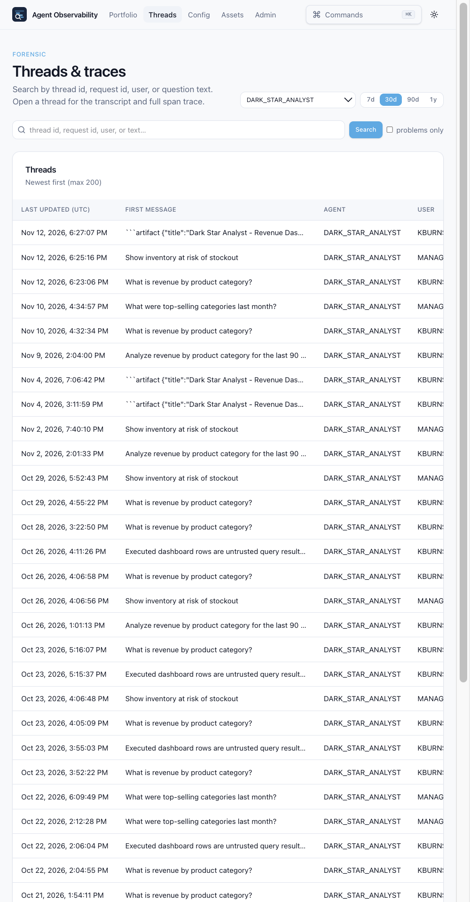
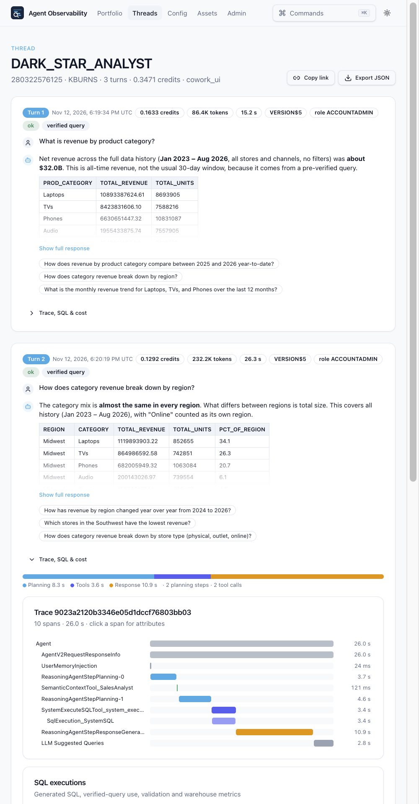
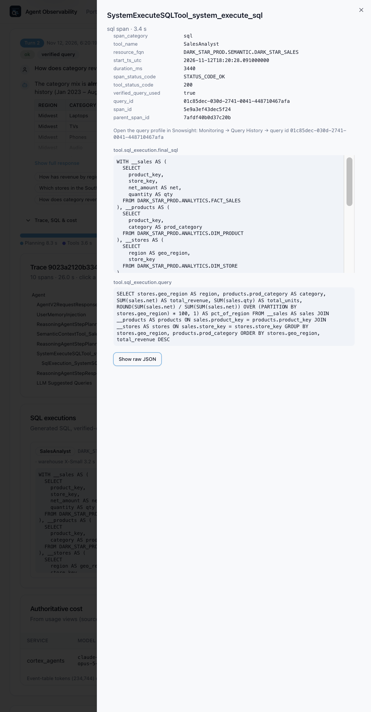
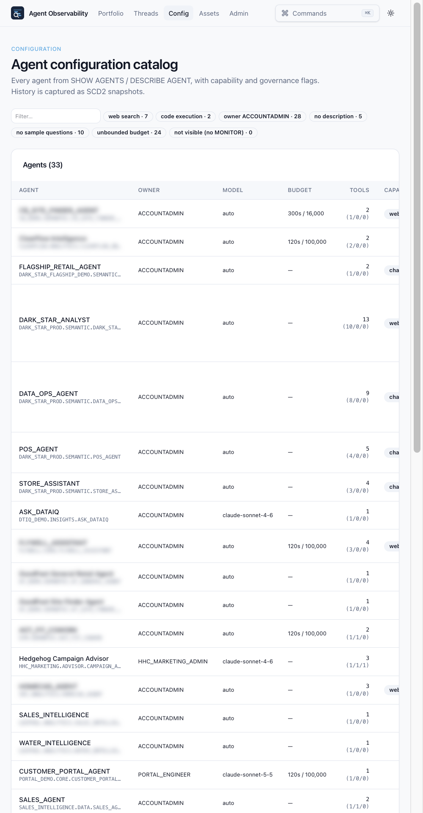
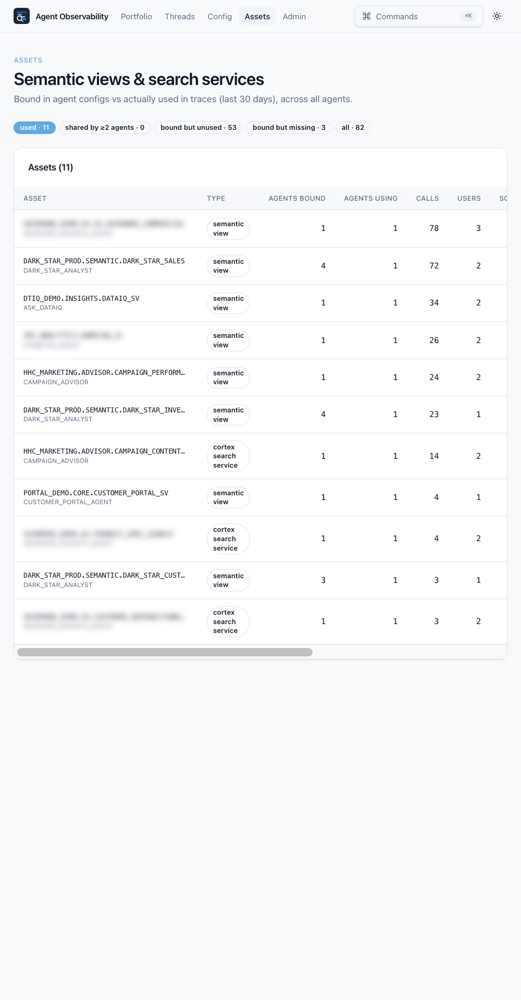

# Agent Observability for Snowflake Cortex Agents

One place to see every **Cortex Agent** and **Snowflake CoWork** interaction in a Snowflake account. It covers adoption, cost, quality, latency and configuration drift, and you can drill into any thread to see its full span trace, much like Snowsight's agent monitoring but for all agents at once.

It has two parts:

1. **`AGENT_OBS` data mart.** A pipeline that copies agent usage, traces, configuration and asset metadata into history tables that are never purged. The source views lose rows as they age out; the mart keeps them.
2. **A Snowflake App Runtime (Next.js) app.** The UI over the mart. Every query runs with **caller's rights**, so each viewer sees only what their own role allows.



> Customer agent names are blurred in these screenshots.

---

## What's in the app

### Portfolio: the account at a glance
KPIs with deltas against the prior period:
- Turns, threads, active users, AI credits, tokens (with cache share), p50/p95 latency, success rate and feedback.
- Daily turns by interface (CoWork UI, Agent admin UI, external API, SQL function, eval, passthrough) and the interface mix.
- A data freshness banner shows how current each source is.

The **agent leaderboard** ranks every agent by turns, users, credits, credits per turn, success and SQL error rate. It flags idle agents, cost outliers (more than 2× the median credits per turn) and success-rate regressions. Turns that don't name an agent object appear as `(CoWork default agent)` or `(inline API agent)`.

**AI spend by product** shows daily credits across Cortex Agents, CoWork, Cortex Code and AI SQL functions for the whole account. A **Cortex Code** section breaks CoCo usage down by surface (Desktop, Snowsight, CLI), model and user. CoCo runs on the agent runtime but owns no agent object, so it's kept out of the agent turn metrics and sourced from the CoCo usage views instead.



### Conversation trends: what people ask
Every distinct question is classified once with `AI_COMPLETE` (structured output). The classifier pulls out the real question, writes a generic canonical form, and assigns an intent, a business domain, metrics, dimensions and a time window. Canonical forms are embedded with `AI_EMBED`, and near-duplicates are grouped into **themes** per agent, so "revenue by category" and "what's our revenue per product category?" count as one theme.

Each theme is joined to its outcomes: asks, people, active weeks, success, verified-query use, SQL errors, latency and feedback. The page flags themes that call for an action:
- **Add verified queries**: frequent SQL answers that rarely use a verified query.
- **Build reports**: metric questions that recur across weeks or from the same person.
- **Fix gaps**: low success, SQL errors, negative feedback or problem reports.
- **Help users**: "what can I ask?" and definition questions.
- **Rising**: demand that doubled in the last 7 days.

Opening a theme shows how people phrase it, links to example threads, and a **verified-query starter**: YAML built from the agent's latest successful SQL, ready to adapt. The page also charts intents and domains over time and lists the most requested metrics and dimensions. Question text and theme labels follow the content tier. The classifier model, theme similarity threshold and batch size are set in `ADMIN.CONFIG`; new questions are classified at the end of each pipeline run.

### End users: who asks, what it costs, where they get stuck
Starts with the headline numbers for people (toggle to include app and service accounts):
- active, new and returning users; questions; credits; questions with issues; feedback; dashboard opportunities
- users per week (new vs returning) and top users by credits
- **segments**: power users, new users, struggling users (2+ issues and a 20%+ issue rate, or negative feedback), users who need onboarding (30%+ "what can I ask?" questions) and users who have gone quiet
- **where users get stuck**: issue reasons (request failed, all SQL attempts failed, SQL error recovered, negative feedback, user-reported problem), plus recent issues and feedback
- **dashboard opportunities**: the same person asking the same kind of metric question on several days, with the credits and wait time a saved dashboard would avoid

Click any user for their profile: daily activity and credits, agents used, kinds of questions, themes they ask about, their own dashboard opportunities, issues, feedback and their latest questions (each linking to the full thread and trace). Accounts are classified as person, service/app or system from the user type and naming conventions.

### Automations: what users have scheduled
Every scheduled automation in the account, from the tasks in users' personal `USER$<name>` databases:
- **CoWork automations**: tasks in `USER$<name>.SNOWFLAKE_INTELLIGENCE` that call `SYSTEM$CORTEX_DATA_AGENT_RUN_V2`. The target agent and the prompt are parsed from the task definition.
- **Cortex Code automations**: agent tasks in `USER$<name>.PUBLIC` named `COCO_ROUTINE_*`.
- **Agent SDK automations**: other agent-run tasks in `USER$<name>.PUBLIC`.

The overview shows active, paused and failing automations, runs per day, success rate and 30-day credits, broken down by owner and by target agent, plus recent failures. Each automation gets a **health** label: healthy, flaky, failing, auto-suspended, paused, never run or deleted. Open an automation to see its prompt (content tier), its schedule in plain English, the last error and its full run history. Each run links to the thread it produced.

Runs come from `TASK_HISTORY` and task compute from `SERVERLESS_TASK_HISTORY`. A run's agent or Cortex Code credits are the usage rows with `trigger_type = 'automation'` for the same user (and agent) during the run. Snowflake keeps automation run history for only two months; the mart keeps it, including for deleted automations.

### Docs: how it works, with the SQL to check it
A built-in help page with a section for each page. Each section explains what the page shows, defines every metric and flag, and gives copy-and-run SQL against Snowflake's own metadata (`ACCOUNT_USAGE`, `SNOWFLAKE.LOCAL.AI_OBSERVABILITY_EVENTS`, `SHOW`/`DESCRIBE`). Anyone with the right access can validate a number or explore further without the mart. Each section also shows the equivalent mart query, and `GET_LINEAGE` queries trace any mart view back to the Snowflake source it came from. The queries share one `SET days / agent / user_name` block, and the page has search, a core-only filter and copy buttons.

### Agent detail
For a single agent:
- Configuration chips: model, budget, tools, capabilities, owner and default version.
- KPIs and daily usage, with markers for config changes.
- Tool usage stats for each tool: calls, error %, average and p95 latency.



### Threads & traces: forensics
Search by thread id, request id, user or question text. Filter by agent or show only problem threads.



Open a thread to see:
- The full transcript, turn by turn: question, answer, result tables, suggested follow-ups, credits, tokens, latency, agent version and role.
- **Trace, SQL & cost** for each turn: a planning/tools/response time bar, a span waterfall, the SQL executions with warehouse metrics, and authoritative cost from the usage views.



Click any span to see its attributes: tool, resource, status, whether a verified query was used, query id, and the generated and final SQL.



### Config: configuration catalog
Every agent from `SHOW AGENTS` / `DESCRIBE AGENT`, flagged for governance review:
- capability flags: web search, code execution
- ownership flags: ACCOUNTADMIN-owned, not visible to the pipeline
- missing content: no description, no sample questions
- unbounded budget

Config history is kept as SCD2 snapshots, and a change log shows spec, owner and version changes.



### Assets: semantic views & search services
Compares the semantic views and Cortex Search services each agent is **bound to** with what traces show it **actually using**. Filters: used, shared by two or more agents, bound but unused, and bound but missing (dropped or not visible).



### Admin
Pipeline and access: your role and content tier, data freshness for each source, and recent pipeline runs.

---

## Architecture

```
SNOWFLAKE.ACCOUNT_USAGE  (Cortex Agent + CoWork + Cortex Code usage, AI functions, query history, users, tasks)  ─┐
SNOWFLAKE.LOCAL.AI_OBSERVABILITY_EVENTS  (agent traces / spans)                ─┼─► RAW ─► CORE ─► MART ─► SAR app
SHOW / DESCRIBE AGENTS, semantic views, Cortex Search services                 ─┘   (never   (dynamic   (views)   (caller's
                                                                                      purged)  tables)              rights)
                                   serverless task graph, every 12 hours
```

| Layer | Contents |
| --- | --- |
| `RAW` | Append-only, deduplicated copies of each source. Never purged, so history outlives the source views' retention. Config is snapshotted on every run. |
| `CORE` | Dynamic tables: turns, threads, spans, tool calls, SQL executions, SCD2 agent config, asset bindings. Turns are joined to authoritative cost from usage. |
| `MART` | `V_*` views that the app reads (`V_TURN`, `V_AGENT_LEADERBOARD_30D`, …). The app reads nothing else. |
| `ADMIN` | Load procedures, the task graph and pipeline status. |

### Pipeline
- `T_AGENT_OBS_ROOT` is a **serverless task graph** on cron `0 */12 * * * UTC`. It loads each source incrementally, then refreshes the mart.
- `SP_SET_SCHEDULE(TRUE|FALSE)` starts or stops the pipeline.
- The ingest role must be able to *see* every agent. `SP_GRANT_INGEST_VISIBILITY` grants MONITOR/USAGE. A guardrail stops the config loader from marking agents as dropped when it suddenly sees far fewer of them; this prevents false tombstones.

### Access model

| Role | Purpose |
| --- | --- |
| `AGENT_OBS_INGEST_ROLE` | Owns the mart and runs the pipeline |
| `AGENT_OBS_APP_ROLE` | Read access to `MART` (metrics and metadata) |
| `AGENT_OBS_CONTENT_ROLE` | Content tier: unmasks questions, responses, SQL text and feedback text |

Content columns use masking policies keyed on `IS_ROLE_IN_SESSION('AGENT_OBS_CONTENT_ROLE')`. Without that role, viewers see metrics and trace structure but masked text (the 🙈 rows in the thread list).

---

## Repository layout

| Path | What |
| --- | --- |
| [`REQUIREMENTS.md`](REQUIREMENTS.md) | Product requirements |
| [`sql/00_setup.sql`](sql/00_setup.sql) | Roles, database, warehouse, source grants |
| [`sql/01_raw.sql`](sql/01_raw.sql) | RAW history tables |
| [`sql/02_load_procs.sql`](sql/02_load_procs.sql) | Incremental load procedures |
| [`sql/03_core.sql`](sql/03_core.sql) | CORE dynamic tables |
| [`sql/04_mart.sql`](sql/04_mart.sql) | MART views |
| [`sql/05_policies.sql`](sql/05_policies.sql) | Content-tier masking policies |
| [`sql/06_tasks.sql`](sql/06_tasks.sql) | Task graph and schedule |
| [`sql/07_app_grants.sql`](sql/07_app_grants.sql) | Caller grants for the app |
| [`sql/08_trends.sql`](sql/08_trends.sql) | Question classification (AI_COMPLETE), embeddings and theme grouping |
| [`sql/09_automations.sql`](sql/09_automations.sql) | Automations loader and views (CoWork / Cortex Code / Agent SDK tasks, runs and cost) |
| [`deploy.sh`](deploy.sh) | Runs the SQL in order |
| [`agent-observability/`](agent-observability) | The SAR Next.js app (`lib/queries.ts` holds every named, bind-only query; `lib/docs.ts` holds the Docs page content and SQL) |

## Setup

Prerequisites: the [Snowflake CLI](https://docs.snowflake.com/en/developer-guide/snowflake-cli/index) (`snow`) with a connection that can use ACCOUNTADMIN, plus Node.js if you want to run the app locally.

1. **Deploy the mart, backfill history and start the 12-hour pipeline:**
   ```bash
   ./deploy.sh <connection> --backfill --start
   ```
   `00_setup.sql` runs as ACCOUNTADMIN; the other scripts run as `AGENT_OBS_INGEST_ROLE`. The script is idempotent.
2. **Grant the app's caller grants:** run `sql/07_app_grants.sql`.
3. **Grant viewers access:** give users `AGENT_OBS_APP_ROLE`, and add `AGENT_OBS_CONTENT_ROLE` for those who may read conversation content.
4. **Deploy the app.** Set `database`, `schema` and `query_warehouse` in `agent-observability/app.yml` for your account, then run:
   ```bash
   cd agent-observability
   snow app setup --app-name=agent_observability
   snow app deploy
   ```
5. **Run locally (optional):**
   ```bash
   cd agent-observability && npm install
   SNOWFLAKE_CONNECTION_NAME=<connection> npm run dev
   ```

## Cost notes
- The pipeline runs on serverless tasks twice a day. Loads are incremental, so steady-state cost is small.
- The app's queries run on the query warehouse you configure, under each viewer's own role.
- Question classification calls `AI_COMPLETE` and `AI_EMBED` once per *new distinct* question, so after the first backfill the cost tracks new questions only.
- Mart storage grows with history by design. Prune `RAW` yourself if you need a retention limit.

## Security
- No credentials are stored in the repo. Local development uses your Snowflake CLI profile; the deployed app uses the platform-issued token.
- All app SQL is pre-defined and parameterized with binds. The app never interpolates user input into SQL.

## License
[Apache 2.0](LICENSE)
